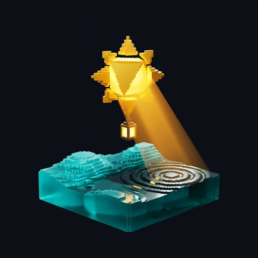
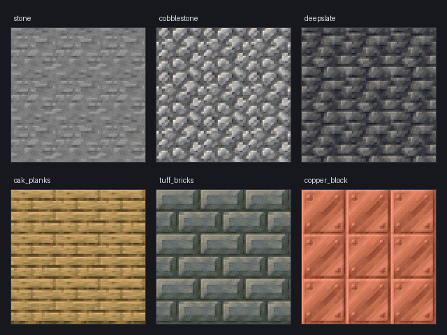
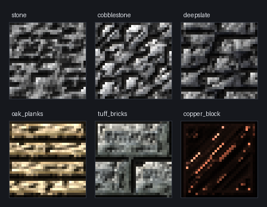

# Minecraft Java Studio — Synergic Triptych (1.21.1)


[](https://github.com/t0mm4s0m4tte/minecraft-studio/actions/workflows/build.yml)
[](https://github.com/sponsors/t0mm4s0m4tte)

A high-performance modular graphics and modding suite for **Minecraft Java Edition 1.21.1**, designed around the **Iris + Sodium** pipeline and the **LabPBR 1.3** standard. It delivers lag-free dynamic lighting, a complete 32x PBR texture collection, and zero-click integration between resource pack and custom shaders.

---

## The Triptych Components

| Icon | Module | Path | Role | Technical Target |
|---|---|---|---|---|
|  | **Ambient Luminescence** | `mods/ambient-luminescence` | Multi-loader client mod (Fabric + NeoForge) for dynamic lighting on players, dropped items, and Trial Chambers 1.21 blocks | Java 21, zero per-frame allocations, async JSON config |
|  | **Aetheria LabPBR 32x** | `packs/aetheria-labpbr-32x` | 32x32 RGBA resource pack with normals, AO, height (`_n`), smoothness, F0/metalness, porosity and emissives (`_s`) across 1,015 blocks and 605 items (4,860 PNGs) with 29 anti-tiling variants | 100% MC 1.21.1 coverage (`--strict --all` 1620/1620 PASS) |
|  | **Luminary Shaders** | `shaders/luminary-shaders` | Iris GLSL shader pack (`#version 330 compatibility`) with GGX PBR, Beer-Lambert water waves, 3D POM, energy-preserving SSR, 5-tap Tent bloom, volumetric godrays, and dedicated weather stage | Target budget `<= 3.8 ms` GPU on `Balanced` |

---

## Visual QA & Seamless Anti-Tiling

Check out the automated visual QA contact sheets verifying seamless 3x3 mosaics and LabPBR lighting response:

| Seamless 3x3 Anti-Tiling Mosaic | Synthetic LabPBR Lit Preview (Normals + Specular) |
|:---:|:---:|
|  |  |

Detailed Modrinth & CurseForge publishing guide available at [docs/MODRINTH_PAGE.md](docs/MODRINTH_PAGE.md).

---

## Shader Profiles (v1.8.0)

| Profile | Shadows & GGX Specular | LabPBR 1.3, SSS & Wetness | SSR & Volumetric Godrays | Atmosphere, AA & Optics | POM & AO |
|---|---|---|---|---|---|
| **Potato** | Disabled | Disabled | Off (`0`) | Minimal / Static (No AA/Clouds) | Off (`0`) |
| **Balanced** *(Default)* | Enabled | Enabled (SSS + Puddles/Ripples + Hand/Entity PBR) | `12-step` Energy SSR + `8-step` Godrays/Shafts | FBM Clouds + Water Fog + 5-Tap Tent Bloom + Auto-Exposure + Luma-Edge AA/CAS | `10-step` POM + Micro-AO (`1`) |
| **Cinematic** | Enabled | Enabled (SSS + Puddles/Ripples + Hand/Entity PBR) | `24-step` Energy SSR + Sky Fallback + `16-step` Godrays/Shafts | FBM Clouds + Water Fog + 5-Tap Tent Bloom + Bokeh DoF + CA + Edge-AA + Motion Blur | `16-step` POM + Screen Cavity (`2`) |

---

## Requirements & Quick Installation

- **Minecraft**: `1.21.1` (Java Edition)
- **Java**: `21` (Temurin recommended)
- **Required Mods**: Fabric Loader `>= 0.16.5` + Fabric API (or NeoForge `21.1.65+`) with **Sodium** and **Iris**

After generating packages in `dist/` with `scripts/package_release.py`:
1. Copy `ambient_luminescence-fabric-1.8.0.jar` (or `neoforge`) into `.minecraft/mods/`.
2. Copy `Aetheria-LabPBR-32x-1.8.0.zip` into `.minecraft/resourcepacks/` and activate it in Minecraft settings.
3. Copy `Luminary-Shaders-1.8.0.zip` into `.minecraft/shaderpacks/` and select it in Iris (`Balanced` active by default with preconfigured LabPBR 1.3).

---

## Development, Validation & Release Commands

```bash
# 1. Generate/expand full 32x LabPBR 1.3 pack (blocks + items + animated textures)
python packs/aetheria-labpbr-32x/scripts/build_full_pack_32x.py

# 2. Strict validation of all LabPBR 1.3 blocks and items (1,620 sets / 4,860 PNGs)
python packs/aetheria-labpbr-32x/scripts/validate_labpbr.py --strict --all

# 3. Automated release packager unit tests
python -m unittest discover -s tests -v

# 4. Compile multi-loader mod (Fabric + NeoForge, requires JDK 21)
cd mods/ambient-luminescence && ./gradlew build

# 5. Build distribution packages (.zip / .jar in dist/)
python scripts/package_release.py
```

---

## Architecture & Technical Contract

Detailed architectural specifications, PBR channel encodings, Iris buffer layouts, and GPU budget constraints are documented in [docs/TECHNICAL_CONTRACT.md](docs/TECHNICAL_CONTRACT.md).

---

## Support & Sponsorship

If you enjoy the Minecraft Studio suite or use it in your SMP servers and modpacks, consider supporting ongoing development via [GitHub Sponsors (@t0mm4s0m4tte)](https://github.com/sponsors/t0mm4s0m4tte). Your sponsorship helps fund continuous PBR asset expansion, shader performance tuning, and multi-loader mod maintenance.
