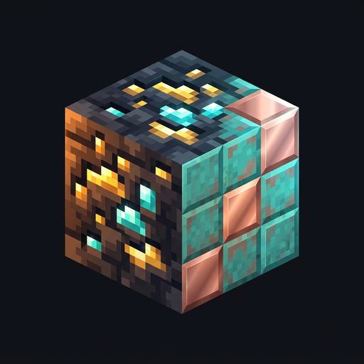

# Minecraft Java Studio — Trittico Sinergico (1.21.1)


[](https://github.com/t0mm4s0m4tte/minecraft-studio/actions/workflows/build.yml)

Suite modulare per **Minecraft Java Edition 1.21.1** costruita attorno alla pipeline **Iris + Sodium** e allo standard **LabPBR 1.3**, progettata per offrire luci dinamiche leggere, materiali PBR 32x coerenti e configurazione zero-click tra resource pack e shader.

## Componenti del Trittico

| Icona | Modulo | Percorso | Ruolo | Target |
|---|---|---|---|---|
|  | **Ambient Luminescence** | `mods/ambient-luminescence` | Mod client multi-loader (Fabric + NeoForge) per luci dinamiche su player, item a terra e blocchi Trial Chambers 1.21 | Java 21, zero allocazioni per frame |
|  | **Aetheria LabPBR 32x** | `packs/aetheria-labpbr-32x` | Resource pack 32x32 RGBA con normal, AO, height (`_n`), smoothness, F0/metalness, porosity ed emissività (`_s`) su 1.015 blocchi e 605 item (4.860 PNG) | Copertura 100% MC 1.21.1 (`--strict` 60/60) |
|  | **Luminary Shaders** | `shaders/luminary-shaders` | Shader pack Iris GLSL (`#version 330 compatibility`) con GGX PBR, onde Beer-Lambert, POM 3D e 3 profili | Budget target `<= 3.8 ms` GPU su `Balanced` |

## Profili Shader (v1.1.0)

| Profilo | Ombre & Specular GGX | LabPBR 1.3 & Rain Wetness | SSR & Volumetric Godrays | Water Caustics & Snell | POM & AO |
|---|---|---|---|---|---|
| **Potato** | Disattivo | Disattivo | Off (`0`) | Disattivo | Off (`0`) |
| **Balanced** *(Default)* | Attivo | Attivo (`Puddles` inclusi) | `12 step` SSR + `8 step` Godrays | Attivo | `10 step` POM + Micro-AO (`1`) |
| **Cinematic** | Attivo | Attivo (`Puddles` inclusi) | `24 step` SSR + `16 step` Godrays | Attivo | `16 step` POM + Screen Cavity (`2`) |

## Requisiti & Installazione Rapida

- **Minecraft**: `1.21.1`
- **Java**: `21` (Temurin consigliato)
- **Mod richieste**: Fabric Loader `>= 0.16.5` + Fabric API (oppure NeoForge `21.1.65+`) con **Sodium** e **Iris**

Dopo aver generato i pacchetti in `dist/` tramite `scripts/package_release.py`:
1. Copia `ambient_luminescence-fabric-1.0.0.jar` (o `neoforge`) in `.minecraft/mods/`.
2. Copia `Aetheria-LabPBR-32x-1.0.0.zip` in `.minecraft/resourcepacks/` e attivalo nelle impostazioni di Minecraft.
3. Copia `Luminary-Shaders-1.0.0.zip` in `.minecraft/shaderpacks/` e selezionalo da Iris (`Balanced` attivo di default con LabPBR 1.3 preconfigurato).

## Comandi di Sviluppo, Validazione e Release

```bash
# 1. Generazione/espansione full pack 32x LabPBR 1.3 (blocchi + item + animazioni)
python packs/aetheria-labpbr-32x/scripts/build_full_pack_32x.py

# 2. Validazione rigorosa dei 60 blocchi core LabPBR 1.3 (180 PNG)
python packs/aetheria-labpbr-32x/scripts/validate_labpbr.py --strict

# 3. Test automatici del packager release
python -m unittest discover -s tests -v

# 4. Compilazione mod Fabric + NeoForge (richiede JDK 21)
cd mods/ambient-luminescence && ./gradlew build

# 5. Generazione pacchetti pronti in dist/
python scripts/package_release.py
```

## Servizi B2B per Server SMP e Creator

Per personalizzazioni grafiche dedicate (resource pack brandizzati, preset shader ottimizzati per eventi o modpack), il listino operativo e i template di contatto sono raccolti in [docs/b2b-outreach.md](docs/b2b-outreach.md).
