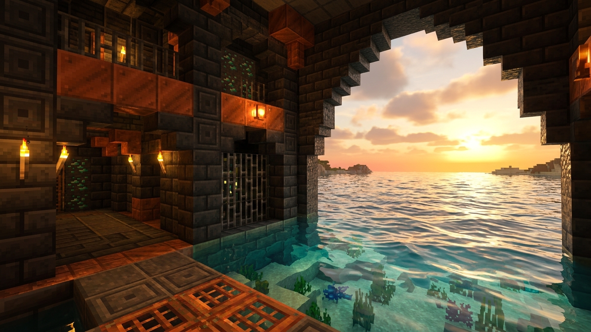

# Minecraft Java Studio — Synergic Triptych (1.21.1)



[](https://github.com/t0mm4s0m4tte/minecraft-studio/actions/workflows/build.yml)

A high-performance modular graphics and modding suite for **Minecraft Java Edition 1.21.1**, designed around the **Iris + Sodium** pipeline and the **LabPBR 1.3** standard. It delivers lag-free dynamic lighting, a complete 32x PBR texture collection, and zero-click integration between resource pack and custom shaders.

---

## The Triptych Components

| Icon | Module | Path | Role | Technical Target |
|---|---|---|---|---|
|  | **Ambient Luminescence** | `mods/ambient-luminescence` | Multi-loader client mod (Fabric + NeoForge) for dynamic lighting on players, dropped items, and Trial Chambers 1.21 blocks | Java 21, zero per-frame allocations |
|  | **Aetheria LabPBR 32x** | `packs/aetheria-labpbr-32x` | 32x32 RGBA resource pack with normals, AO, height (`_n`), smoothness, F0/metalness, porosity and emissives (`_s`) across 1,015 blocks and 605 items (4,860 PNGs) | 100% MC 1.21.1 coverage (`--strict` 60/60 PASS) |
|  | **Luminary Shaders** | `shaders/luminary-shaders` | Iris GLSL shader pack (`#version 330 compatibility`) with GGX PBR, Beer-Lambert water waves, 3D POM, SSR, volumetric godrays, and dedicated weather stage | Target budget `<= 3.8 ms` GPU on `Balanced` |

---

## Shader Profiles (v1.3.0)

| Profile | Shadows & GGX Specular | LabPBR 1.3, SSS & Wetness | SSR & Volumetric Godrays | Atmosphere & Optics | POM & AO |
|---|---|---|---|---|---|
| **Potato** | Disabled | Disabled | Off (`0`) | Minimal / Static | Off (`0`) |
| **Balanced** *(Default)* | Enabled | Enabled (SSS + Puddles) | `12-step` SSR + `8-step` Godrays | Auto-Exposure + Height Fog + Waving | `10-step` POM + Micro-AO (`1`) |
| **Cinematic** | Enabled | Enabled (SSS + Puddles) | `24-step` SSR + `16-step` Godrays | Auto-Exposure + Bokeh DoF + CA + Fog | `16-step` POM + Screen Cavity (`2`) |

---

## Requirements & Quick Installation

- **Minecraft**: `1.21.1` (Java Edition)
- **Java**: `21` (Temurin recommended)
- **Required Mods**: Fabric Loader `>= 0.16.5` + Fabric API (or NeoForge `21.1.65+`) with **Sodium** and **Iris**

After generating packages in `dist/` with `scripts/package_release.py`:
1. Copy `ambient_luminescence-fabric-1.3.0.jar` (or `neoforge`) into `.minecraft/mods/`.
2. Copy `Aetheria-LabPBR-32x-1.3.0.zip` into `.minecraft/resourcepacks/` and activate it in Minecraft settings.
3. Copy `Luminary-Shaders-1.3.0.zip` into `.minecraft/shaderpacks/` and select it in Iris (`Balanced` active by default with preconfigured LabPBR 1.3).

---

## Development, Validation & Release Commands

```bash
# 1. Generate/expand full 32x LabPBR 1.3 pack (blocks + items + animated textures)
python packs/aetheria-labpbr-32x/scripts/build_full_pack_32x.py

# 2. Strict validation of 60 core LabPBR 1.3 blocks (180 PNGs)
python packs/aetheria-labpbr-32x/scripts/validate_labpbr.py --strict

# 3. Automated release packager unit tests
python -m unittest discover -s tests -v

# 4. Compile multi-loader mod (Fabric + NeoForge, requires JDK 21)
cd mods/ambient-luminescence && ./gradlew build

# 5. Build distribution packages (.zip / .jar in dist/)
python scripts/package_release.py
```

---

## Architecture & Technical Contract

Detailed architectural specifications, PBR channel encodings, Iris buffer layouts, and GPU budget constraints are documented in [docs/TECHNICAL_CONTRACT.md](docs/TECHNICAL_CONTRACT.md).

---

## B2B Custom Services for SMP Servers & Creators

For custom graphics branding (tailored server resource packs, custom shader presets optimized for events or modpacks), check out the service tiers and contact guidelines in [docs/b2b-outreach.md](docs/b2b-outreach.md).
