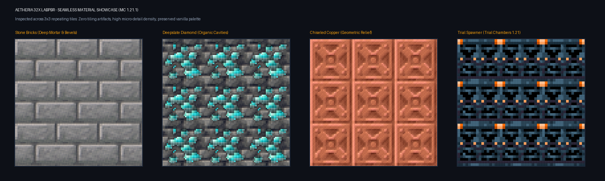
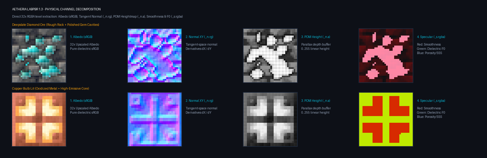

# Minecraft Java Studio — Synergic Triptych (MC 1.21.1)

Welcome to the official Modrinth & CurseForge overview for the **Minecraft Java Studio Synergic Triptych** — an integrated, zero-compromise graphics and immersion ecosystem built for **Minecraft 1.21.1**.

The suite combines a multi-loader dynamic lighting engine, a complete 32x LabPBR 1.3 resource pack, and an Iris GLSL shader pack engineered to work seamlessly out-of-the-box.

---

## The Triptych Components

| Aetheria 32x Showcase | LabPBR 1.3 Channel Breakdown |
|:---:|:---:|
|  |  |

### 1. Ambient Luminescence (v2.0.0)
*Platform-agnostic dynamic lighting for Fabric & NeoForge.*
- **Zero Per-Frame Allocation**: Built on FastUtil primitive collections, double-buffered spatial caches, `Long2IntMaps.fastIterable`, and a precomputed 3D `DIST_LEN` Euclidean LUT (`O(1)` lookup) combined with proportional radial scaling.
- **Asynchronous Client Configuration**: Non-blocking config (`config/ambient_luminescence.json`) initialized on `Util.ioPool()` with automatic timestamp polling every 100 client ticks (`pollReloadAsync()`). Configurable maximum light radius (clamped `4..14` with calibrated radial falloff), entity illumination, dropped item glows, helmet dynamic lighting across all living entities, and fire entity lighting.
- **Full MC 1.21.1 Coverage**: Out-of-the-box dynamic lights for copper bulbs (all oxidation stages), froglights, end rods, campfires, beacons, conduits, enchanting tables, dropped items, and living entities (`Allay`, `EndCrystal`, `Blaze`, `MagmaCube`, fireballs, spectral arrows).
- **Physical Immersion**: Real-time underwater flame extinguishment for torches and campfires.

### 2. Aetheria LabPBR 32x (v2.0.0)
*A pristine 32x32 LabPBR 1.3 material pack covering the entire vanilla catalog.*
- **1,620 Asset Sets (4,860 RGBA PNGs)**: Complete coverage for 1,015 blocks and 605 items validated strictly against LabPBR 1.3 specs (`--strict --all` 1620/1620 PASS).
- **Physical Normals & Height**: Clean normal reconstruction (`_n.png`) with ambient occlusion in Blue and heightfield displacement in Alpha.
- **Material Response**: Fine-tuned smoothness, F0 metalness, porosity, subsurface scattering, and bounded emissives (`_s.png`).
- **54 Seamless Anti-Tiling Blockstates**: Multi-rotation variants (`0° / 90° / 180° / 270°`) eliminating repetitive grid patterns on terrain and architecture (stone, deepslate, granite, diorite, tuff, mud, clay, stone bricks, deepslate tiles, moss, blackstone, soul soils, tuff bricks, prismarines, nether bricks, end stone bricks, calcite, terracotta, obsidian, purpur, snow and ice).

### 3. Luminary Shaders (v2.0.0)
*High-fidelity Iris GLSL shader pipeline targeting maximum visual payoff within tight GPU frame budgets.*
- **Multi-Scatter GGX Energy Compensation**: Physical Turquin energy compensation eliminating microfacet energy loss darkening on rough metals and dielectrics.
- **World-Space Foliage Shadow Sync**: Perfect wave phase match between terrain and shadow passes via `shadowModelViewInverse`.
- **Cotangent 3D Normal Mapping**: Full screen-space cotangent normal decoding (`_n.png`) on all 605 first-person held items and living entities.
- **Energy-Preserving SSR**: View-space screen-space reflections with binary search refinement, dynamic rough jitter-blur, and smooth sky fallback gradient during ray misses.
- **5-Tap Tent Bloom**: Karis/Tent filter highlights on `colortex3` delivering soft, cinematic glow on emissive blocks and torches without light bleeding artifacts.
- **Volumetric Godrays & Underwater Shafts**: Dithered raymarching with Henyey-Greenstein forward scattering and underwater caustic shafts.
- **Parallax Occlusion Mapping (POM)**: 3D self-shadowed depth on building materials with edge-fade silhouette protection.
- **Weather Dynamics**: Rain puddle accumulation, caustic ripples, and particle forward-lighting.

---

## Shader Profiles

| Feature / Setting | Potato (`0`) | Balanced (`1` - Default) | Cinematic (`2`) |
|---|---|---|---|
| **Shadow Mapping** | Off | 2048x Distorted Soft Shadows | 4096x PCSS Soft Shadows |
| **LabPBR 1.3 Material Shading** | Off | Full (GGX + F0 Metal + SSS) | Full (GGX + F0 Metal + SSS) |
| **Screen-Space Reflections (SSR)** | Off | 12-Step + Roughness Jitter | 24-Step + Refinement + Sky Fallback |
| **Volumetric Godrays / Shafts** | Off | 8-Step Dithered | 16-Step Dithered + Water Caustics |
| **Parallax Occlusion Mapping** | Off | 10-Step Depth | 16-Step Depth + Self-Shadowing |
| **Bloom & Post-Processing** | Minimal Fast Bloom | 5-Tap Tent Bloom + CAS Sharpening | 5-Tap Tent Bloom + Bokeh DoF + Chromatic Aberration |
| **Target GPU Budget (1440p)** | `< 1.2 ms` | `<= 3.8 ms` | `<= 6.5 ms` |

---

## Requirements

- **Minecraft**: `1.21.1` (Java Edition)
- **Java**: `Java 21` (Temurin / Adoptium or Oracle)
- **Mod Loaders**:
  - **Fabric**: Fabric Loader `>= 0.16.5` + Fabric API + **Sodium** + **Iris**
  - **NeoForge**: NeoForge `>= 21.1.65` + **Iris/Sodium** (or compatible fork)

---

## Installation Guide

1. Download the release artifacts from Modrinth / GitHub:
   - `ambient_luminescence-fabric-2.0.0.jar` (or `neoforge`)
   - `Aetheria-LabPBR-32x-2.0.0.zip`
   - `Luminary-Shaders-2.0.0.zip`
2. Place `ambient_luminescence-*.jar` into your `.minecraft/mods/` directory.
3. Place `Aetheria-LabPBR-32x-1.9.0.zip` into your `.minecraft/resourcepacks/` directory and enable it in **Options > Resource Packs**.
4. Place `Luminary-Shaders-1.9.0.zip` into your `.minecraft/shaderpacks/` directory and select it in **Video Settings > Shader Packs**.
5. Enjoy completely harmonized LabPBR 1.3 materials with dynamic lights and fluid shaders!

---

## Community & GitHub Sponsorship

The Minecraft Studio suite is an open-source labor of love. If this suite enhances your gameplay, SMP server, or modpack, consider supporting development on GitHub Sponsors:

👉 **[Sponsor @t0mm4s0m4tte on GitHub](https://github.com/sponsors/t0mm4s0m4tte)**
